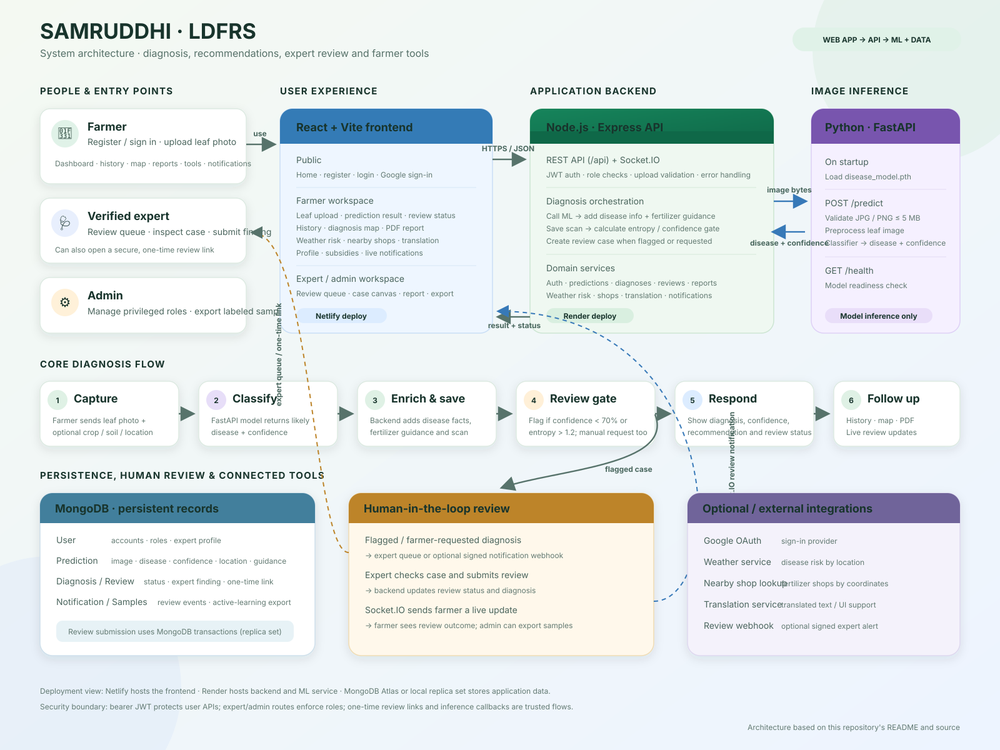

# SAMRUDDHI (LDFRS)

**Sustainable Agriculture Model for Resource Utilisation, Disease Diagnostics, and Health Initiative** is a web application for crop leaf disease diagnosis and related farming guidance. A farmer uploads a leaf image, receives a model prediction and fertilizer guidance, and can request a human expert review. The app also includes diagnosis history, weather risk, nearby shops, translation, notifications, and PDF reports.

## Architecture



The diagram follows a leaf photo from the farmer's browser through the Express API and FastAPI disease model, then shows how the diagnosis is saved, reviewed, and returned to farmer, expert, or admin workspaces.

## Features

- Farmer registration, email/password login, and optional Google sign-in.
- Leaf disease prediction from JPG, JPEG, or PNG images (up to 5 MB).
- Fertilizer recommendations from optional soil and crop inputs.
- Diagnosis history, map locations (only when provided), and downloadable reports.
- Automatic expert review flagging when confidence is below 70% or prediction entropy is above 1.2. Farmers can also request a review manually.
- Expert review queue, one-time review links, review notifications, and admin active-learning export.
- Weather-based disease risk, nearby fertilizer shops, and text translation.

## Project structure

```text
backend/src/       Express API, MongoDB models, authentication, and business logic
frontend/          React + Vite web application
ml-service/        FastAPI image inference service and model checkpoint
```

## Use the deployed app or run locally

### Deployed services

- **Backend API:** [https://samruddhi-r1qe.onrender.com](https://samruddhi-r1qe.onrender.com)
- **API health:** [https://samruddhi-r1qe.onrender.com/api/health](https://samruddhi-r1qe.onrender.com/api/health)

The repository configures Netlify to build and publish the frontend, but does not contain the Netlify site's public URL. Open the site's **Production deploy** URL from the Netlify dashboard to use the deployed web app. The deployed frontend uses the backend API above by default, so no local services or `.env` files are needed when using that site. MongoDB and the deployed ML service must be available for sign-in and predictions to work.

### Local services

To develop or run the application on your machine, configure the local environment below and start the ML service, backend, and frontend in separate terminals. The local frontend will be at `http://localhost:5173`, and the local backend API at `http://localhost:5000`.

## Requirements

- Node.js and npm
- Python 3.10+ and pip
- MongoDB (MongoDB Atlas or a local MongoDB replica set)
- The bundled model checkpoint at `ml-service/models/disease_model.pth`

MongoDB transactions are used when an expert submits a review. Use a replica set; MongoDB Atlas provides one. A standalone local MongoDB server may not support that workflow.

## Configuration

Create `backend/.env` (or `backend/src/.env`) with at least:

```env
PORT=5000
MONGO_URI=mongodb://127.0.0.1:27017/ldfrs
JWT_SECRET=replace-with-a-long-random-secret
```

For local development, the ML service is expected at port **8001** by default. You can override it in `backend/.env`:

```env
LOCAL_ML_API_URL=http://localhost:8001
```

When local ML is unavailable, the backend uses `ML_API_URL` if configured. Set it to the base URL of the deployed FastAPI service, without `/predict`.

Optional backend settings:

```env
FRONTEND_URL=http://localhost:5173
BACKEND_URL=http://localhost:5000
GOOGLE_CLIENT_ID=your-google-oauth-client-id
EXPERT_REVIEW_WEBHOOK_URL=https://your-notification-service.example/hitl
EXPERT_REVIEW_WEBHOOK_SECRET=replace-with-a-long-random-secret
INFERENCE_CALLBACK_SECRET=replace-with-a-different-long-random-secret
```

Google sign-in requires the same OAuth client ID in the frontend and backend. Add your frontend origin (for local development, `http://localhost:5173`) to the OAuth client's authorized JavaScript origins.

Create `frontend/.env` for local use:

```env
VITE_API_URL=http://localhost:5000/api
VITE_GOOGLE_CLIENT_ID=your-google-oauth-client-id
```

The frontend has a hosted API URL fallback when `VITE_API_URL` is not set, so use the local setting above when running the backend on your machine.

The ML service optionally reads `ml-service/.env`:

```env
MODEL_PATH=models/disease_model.pth
PORT=8001
```

Do not commit real secrets or production `.env` files. Keep the inference callback secret different from the webhook signing secret.

## Run locally

Open three terminals from the repository root.

### 1. Start the ML service

```bash
cd ml-service
python -m venv .venv
```

Activate the environment, then install and run the service:

```bash
# Windows PowerShell
.\.venv\Scripts\Activate.ps1

# macOS/Linux (use this instead of the Windows activation command)
# source .venv/bin/activate

pip install -r requirements.txt
python -m uvicorn app:app --host 0.0.0.0 --port 8001
```

Check `http://localhost:8001/health`. The response should report `"model_loaded": true`.

### 2. Start the backend

```bash
cd backend/src
npm install
npm start
```

The backend listens on `http://localhost:5000` by default. Check `http://localhost:5000/api/health` and `http://localhost:5000/api/health/ml`.

### 3. Start the frontend

```bash
cd frontend
npm install
npm run dev
```

Open `http://localhost:5173` in your browser. For a production frontend build, run `npm run build` from `frontend/`; Vite writes the output to `frontend/dist/`.

## Use the application

1. Open the frontend and register an account, or choose Google sign-in if configured. Public registration creates farmer accounts.
2. Sign in and upload a clear JPG, JPEG, or PNG leaf photo (maximum 5 MB).
3. Optionally enter crop, soil nutrient, pH, growth-stage, or location details where the interface offers them. Location is used only when supplied.
4. Review the predicted disease, confidence, fertilizer guidance, and diagnosis status. A low-confidence or high-entropy diagnosis is flagged for expert review automatically. You can also request a review from its status panel.
5. Use History for previous scans and reports. Other dashboard tools include weather risk, nearby shops, translation, and notifications.

## Test the API with Postman

Set a Postman environment variable `baseUrl` to `http://localhost:5000`.

### Register

`POST {{baseUrl}}/api/auth/register` with **Body → raw → JSON**:

```json
{
  "name": "Asha Kumar",
  "email": "asha@example.com",
  "password": "yourPassword123"
}
```

Registration returns a token. Alternatively, log in:

`POST {{baseUrl}}/api/auth/login`

```json
{
  "email": "asha@example.com",
  "password": "yourPassword123"
}
```

For both requests set `Content-Type: application/json`; they do not require an Authorization header. Copy the returned token and use Postman's **Authorization → Bearer Token** for protected routes, or set the header exactly as `Authorization: Bearer <token>` (no trailing space in the header name).

### Confirm authentication

`GET {{baseUrl}}/api/auth/me` with the bearer token. A successful response includes the signed-in user.

### Run a leaf prediction

`POST {{baseUrl}}/api/predictions/predict` with the bearer token and **Body → form-data**:

| Key | Type | Example |
| --- | --- | --- |
| `image` | File | Choose a JPG, JPEG, or PNG leaf image |
| `crop` | Text (optional) | `tomato` |
| `latitude` | Text (optional) | `12.97` |
| `longitude` | Text (optional) | `77.59` |

Do not manually set the multipart `Content-Type`; Postman adds its boundary. The response includes `predictionId`, `diagnosisId`, confidence, and `reviewStatus` / `flagReason`.

Other useful authenticated requests:

| Method | Route | Notes |
| --- | --- | --- |
| `GET` | `/api/predictions/history` | Current user's predictions |
| `GET` | `/api/diagnoses/:id/status` | Current user's diagnosis review status |
| `POST` | `/api/diagnoses/:id/request-review` | Manually send a diagnosis for expert review |
| `GET` | `/api/notifications` | Review notifications |
| `GET` | `/api/notifications/unread-count` | Unread notification count |
| `POST` | `/api/weather-risk/analyze` | JSON body: `{"location":"Bengaluru","disease":"Tomato Early Blight"}` |
| `POST` | `/api/translation/translate` | JSON body: `{"text":"Hello","sourceLanguage":"en","targetLanguage":"hi"}` |
| `GET` | `/api/shops/nearby?latitude=12.97&longitude=77.59` | Optional query parameters: `fertilizer`, `radiusKm`, `limit` |

The health endpoint `GET {{baseUrl}}/api/health` is public and does not need a token.

## Expert and admin accounts

The login page supports Farmer, Expert, and Admin roles. Registration always creates a farmer account; do not pass a role in a public registration request. To enable expert review for a demonstration, create the user, then assign `role: "expert"` and `expertProfile.isVerified: true` through a trusted database administration process. Admin accounts must be assigned `role: "admin"` the same way. Never expose role assignment to public users.

Expert queue: `GET /api/reviews/queue` (verified expert or admin token). Admin active-learning export: `GET /api/reviews/active-learning/export` (admin token). Review submissions use `POST /api/reviews/submit/:reviewId` and require a pending review plus expert/admin access or a valid one-time review session.

Expert notifications are optional. If configured, the backend sends HTTPS POST requests with an `X-LDFRS-Signature: sha256=<hex>` HMAC signature. The one-time review link expires after 48 hours and is consumed when opened; treat it as a secret. The inference callback route is for trusted integrations and requires `X-Inference-Secret` matching `INFERENCE_CALLBACK_SECRET`.

## API overview

All backend routes use the `/api` prefix.

| Area | Routes |
| --- | --- |
| Authentication | `POST /auth/register`, `POST /auth/login`, `POST /auth/google`, `GET /auth/me`, `POST /auth/logout` |
| Predictions | `POST /predictions/predict`, `GET /predictions/history`, `GET /predictions/map`, `GET /predictions/:id/report` |
| Diagnoses | `GET /diagnoses/:id/status`, `GET /diagnoses/:id/image`, `POST /diagnoses/:id/request-review` |
| Reviews | `GET /reviews/queue`, `POST /reviews/submit/:reviewId`, `GET /reviews/:reviewId/report`, `GET /reviews/active-learning/export` |
| Other tools | `/weather-risk/analyze`, `/shops/nearby`, `/translation/translate`, `/notifications` |
| Health | `GET /health`, `GET /health/ml` |

Most routes require a bearer token. Role-specific routes require a verified expert or admin account as described above.

## Troubleshooting

- **MongoDB connection failed:** Check that MongoDB is running and `MONGO_URI` is correct.
- **ML service unavailable:** Start FastAPI on port 8001, then check `/health/ml` on the backend. Confirm `LOCAL_ML_API_URL` or `ML_API_URL` if using a different host.
- **Prediction upload rejected:** Use a JPG/JPEG/PNG image no larger than 5 MB and send it as form-data under the key `image`.
- **401 on a protected Postman route:** Sign in again and send `Authorization: Bearer <token>` with no extra spaces in the header name.
- **Review submission fails on local MongoDB:** Configure MongoDB as a replica set, or use MongoDB Atlas.
- **Google sign-in unavailable:** Set matching `GOOGLE_CLIENT_ID` and `VITE_GOOGLE_CLIENT_ID`, and allow the frontend origin in Google OAuth settings.

